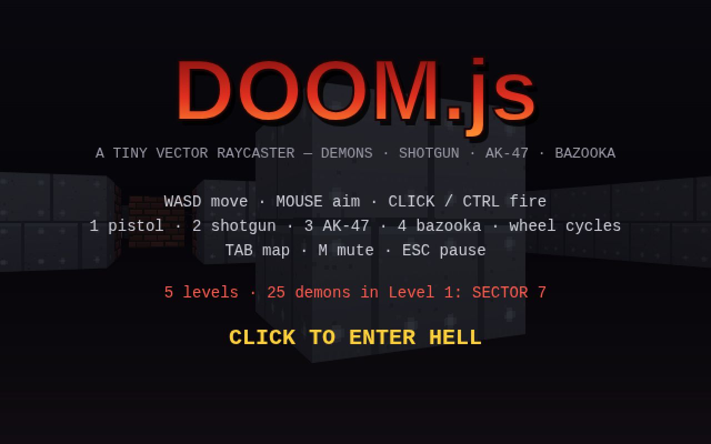
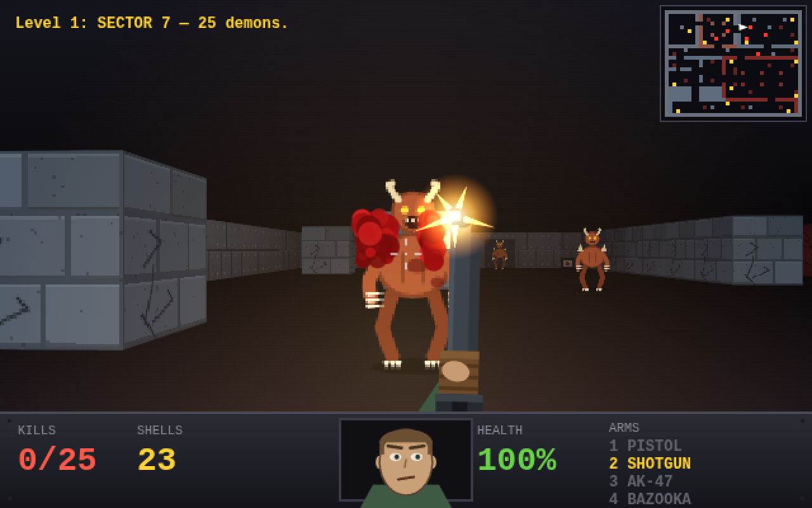
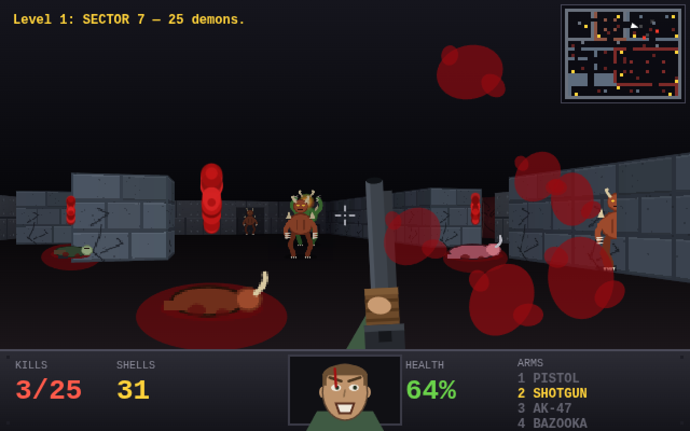
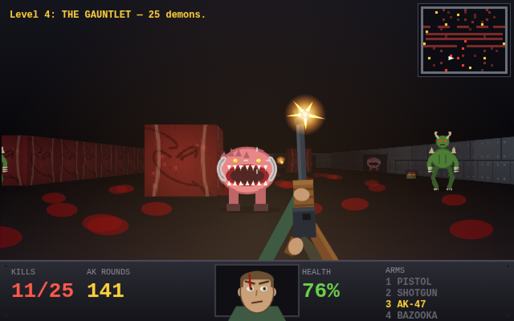
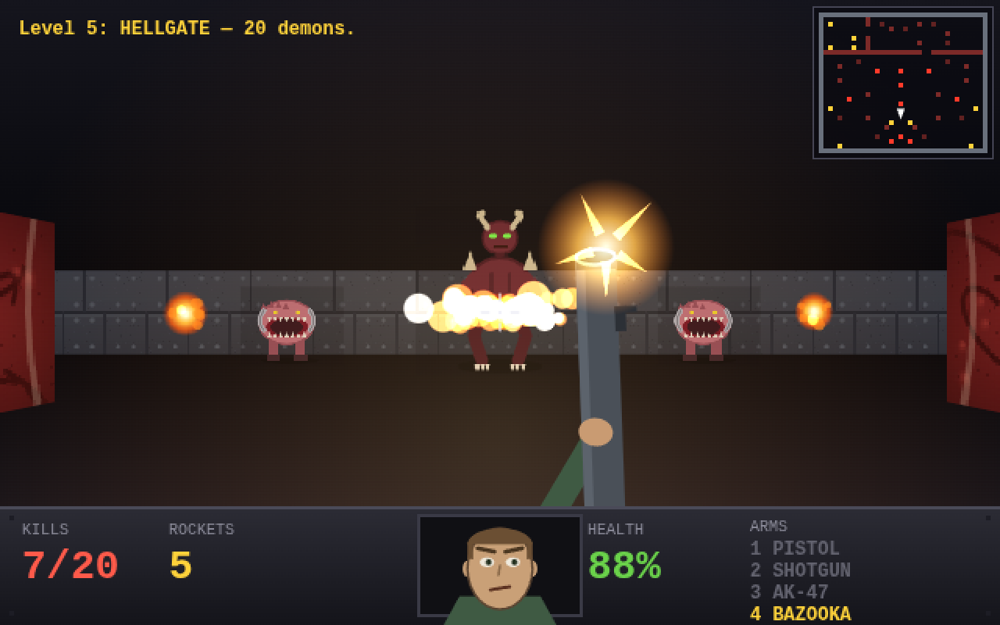

# DOOM.js

A tiny DOOM-like first-person shooter in pure JavaScript + Canvas. No assets,
no dependencies: every wall texture, monster sprite and sound is generated
procedurally (vector-drawn / WebAudio-synthesized) at startup.

**[▶ PLAY IT IN YOUR BROWSER](https://matveyev.github.io/doomjs/)**

## Screenshots

| | |
|---|---|
|  |  |
|  |  |

## Run it

Any static file server works, e.g.:

    python3 -m http.server 8099
    # open http://localhost:8099

Or just double-click `index.html` — it runs straight from disk (classic
scripts, no modules, no fetch; pointer lock works from `file://` in
Chrome/Firefox/Edge, and arrow-key turning is the fallback if a browser
refuses it).

## Controls

| Input | Action |
|---|---|
| WASD / arrows | move / turn |
| mouse | aim (click to lock the pointer) |
| click / ctrl | fire |
| 1 / 2 / 3 / 4 | pistol / shotgun / AK-47 / bazooka (wheel cycles) |
| Tab | toggle minimap |
| M | mute |
| Esc | pause |

## Cheats (type them mid-game)

| Code | Effect |
|---|---|
| `iddqd` | god mode (toggling it on also heals to 100) |
| `idkfa` | full arsenal: 50 shells, 240 rounds, 30 rockets |
| `idclip` | walk through walls |

## The campaign — 5 levels

1. **SECTOR 7** — tech base, brick hall, stone courtyard (25 demons)
2. **THE VAULTS** — stone ring around four vault rooms
3. **COURTYARD OF FIRE** — brick cloister around a pillared arena
4. **THE GAUNTLET** — serpentine flesh corridors into a pinky swarm
5. **HELLGATE** — the Baron of Hell waits at the bottom (500 HP, triple fireballs)

Weapons, ammo and health carry over between levels. Dying restarts the
current level with a fresh loadout. Clear level 5 to get the HELL CLEARED
screen with your run total.

## Weapons

- **Pistol** — infinite ammo backup
- **Shotgun** — 7 pellets, pump animation, brutal up close
- **AK-47** — full auto; spread blooms and the rifle climbs as it heats up
- **Bazooka** — slow rockets with splash damage (careful: the blast hurts
  you too), scorch marks and gib showers

Ammo boxes give +4 shells, +20 rounds and +2 rockets.

## Documentation

Full technical docs live in [`docs/`](docs/index.md):

- [architecture.md](docs/architecture.md) — files, boot, game loop, states, input, cheats
- [renderer.md](docs/renderer.md) — raycasting math, sprite casting, decals, fog
- [entities.md](docs/entities.md) — monster AI, projectiles, rockets, pickups
- [weapons.md](docs/weapons.md) — weapon defs, hitscan, AK heat, rockets
- [effects-and-audio.md](docs/effects-and-audio.md) — gore FX, sprite baking, WebAudio
- [level-format.md](docs/level-format.md) — map charset, parsing, campaign flow
- [modding.md](docs/modding.md) — **how to add levels, weapons and monsters**

## Code map

    index.html        — canvas shell, scanline/vignette overlay
    js/util.js        — tiny helpers
    js/textures.js    — procedural wall textures (tech/brick/stone/flesh)
    js/sprites.js     — vector-drawn monster/item sprite frames + fog baking
    js/audio.js       — WebAudio synth (guns, rockets, growls, drone)
    js/level.js       — the 5 maps (ASCII grids) and spawn parsing
    js/effects.js     — blood particles, decals, explosions, splatter
    js/entities.js    — monster AI, projectiles, rockets, pickups, raycast
    js/weapon.js      — pistol/shotgun/AK/bazooka logic + vector weapon art
    js/render.js      — DDA raycaster, sprite z-clipping, floor decals
    js/hud.js         — status bar, marine face, minimap, screens
    js/main.js        — game state, input, cheats, level flow, main loop
    tools/validate.js — node script: checks every map's integrity/reachability

Internal render resolution is 640×400 (CSS-scaled, pixelated) with square world
units — the camera plane is 0.8, matching the 8:5 viewport.
